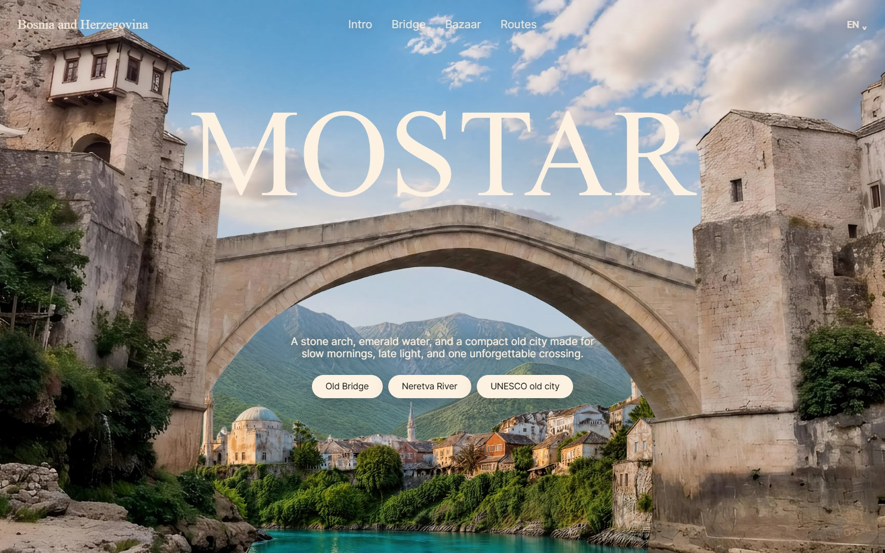

<div align="center">
  <a href="https://rushikeshgarad2024-dev.github.io/mostar-city/">
    
  </a>
</div>

<div align="center">

# Mostar City — Cinematic Scroll

**A three-act, scroll-driven journey through Bosnia's Old Bridge city.**

[](https://rushikeshgarad2024-dev.github.io/mostar-city/)
[](https://developer.mozilla.org/docs/Web/HTML)
[](https://developer.mozilla.org/docs/Web/CSS)
[](https://developer.mozilla.org/docs/Web/JavaScript)
[](https://github.com/rushikeshgarad2024-dev/mostar-city)

</div>

---

## The idea

Mostar's Stari Most is more than a landmark — it is the city's compass. This page treats the crossing as a film: an opening over the Neretva, a middle act under the stone arch, and a final act through the bazaar lanes.

Everything is driven by scroll and pointer position, with no framework, no build step, and no dependencies.

## Highlights

- **Scroll-linked cinema** — layered scenes, split frames, scale, blur, and depth transitions tied to a single scroll timeline.
- **Pointer parallax** — the hero, bridge, and background respond subtly to cursor movement.
- **Infinite sights slider** — five Mostar sights (Stari Most, Kujundžiluk, Koski Mehmed Pasha Mosque, Kajtaz House, War Photo Exhibition) in a looping, keyboard-accessible carousel.
- **Reduced-motion support** — transitions collapse cleanly when `prefers-reduced-motion` is set.
- **Fully static** — deployable to GitHub Pages, Netlify, Vercel, or any file host.
- **Responsive** — layouts adapt from wide desktop screens down to mobile.

## Tech

| Layer | Choice |
| :--- | :--- |
| Markup | Semantic HTML5 |
| Styling | Modern CSS — custom properties, `clamp()`, layered transforms |
| Animation | Vanilla JavaScript, `requestAnimationFrame`, scroll-linked math |
| Assets | Remote scene art, loaded progressively |
| Build | None |

## Run locally

```bash
# from the project root
python -m http.server 8000
```

Then open <http://localhost:8000>. Opening `index.html` directly also works in most browsers.

## Project structure

```text
.
├── index.html      # markup and story content
├── styles.css      # scene layout, type, responsive rules
├── script.js       # scroll timeline, parallax, sights slider
├── assets/
│   └── preview.jpg # README preview
└── .nojekyll       # GitHub Pages configuration
```

## Publish

This repo is already live on GitHub Pages:

**https://rushikeshgarad2024-dev.github.io/mostar-city/**

To publish a fork, enable **Settings → Pages → Deploy from branch → `master` / root**.

## Credits

Design and build by **[Rushikesh Garad](https://github.com/rushikeshgarad2024-dev)**.

Scene photography and visual assets belong to their respective owners and are used here for demonstration.
